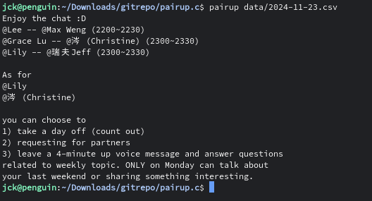
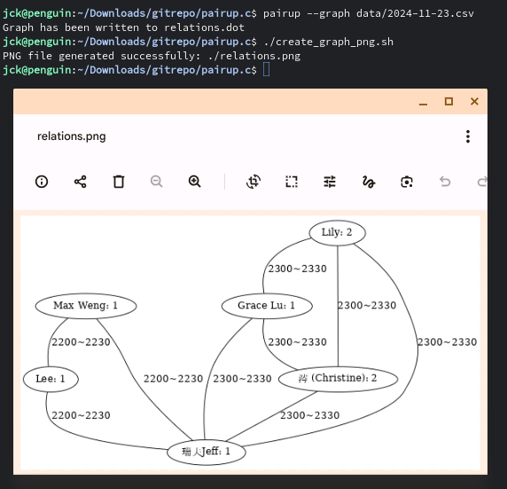

# pairup.c

`pairup` is a command-line tool that pairs up members of an English study group for daily speaking practice.

Every day, members mark the 30-minute slots they are free on a shared Google Sheet, and whether they want to practice once or twice. `pairup` reads that sheet and posts a ready-to-send message: who practices with whom and when, plus suggested times for anyone left without a partner. The result always has the **maximum possible number of pairs**.


## Pairing rules

- A pair meets in one time slot that both members filled in.
- A member joins at most as many pairs as they requested (`1` or `2`), uses each slot at most once, and never meets the same partner twice.
- With `--ensure`, the listed members get a partner first whenever possible.
- With `--enable-flex`, the `FLEX` column counts as one more slot. Fixed slots are preferred over it.
- When several pairings are equally good, rows are shuffled first, so each run may pick a different one.

## Sheet format

| Row | Content |
|---|---|
| Header | Name column, an unused column, then one column per time slot (`1700~1730`, `1730~1800`, ...), then an optional `FLEX` column |
| Members | Name, then `1` / `V` / `X` (practice once) or `2` (practice twice) in each free slot |
| Summary | A row named `填答數` (or the last row, if no row has that name). It is ignored. |

Rows without a name are ignored. Run with `-d 2` to see which rows were skipped.

## Usage

```bash
./get_today_google_sheet.sh                 # download today's sheet to data.csv
./pairup data.csv                           # print today's pairs
```

| Option | Description |
|---|---|
| `-e, --ensure=MEMBER` | Make sure `MEMBER` gets a partner if at all possible. Can be repeated. |
| `-F, --enable-flex` | Also pair members who filled in the `FLEX` column. |
| `-j, --json-output` | Print the result as JSON. |
| `-g, --graph[=FILE]` | Draw who can practice with whom, plus the full ILP sent to the solver (default `relations.png`, needs [Graphviz](https://graphviz.org)). |
| `-s, --show-csv` | Show the parsed sheet only. |
| `-d, --debug=LEVEL` | `0` errors only (default), `2` warnings, `3` summary, `4` info, `5` everything including solver logs. |
| `-v, --version` / `-h, --help` | Version / help. |

`--graph` takes its file name attached: `--graph=out.png` or `-gout.png`. With `-g out.png`, `out.png` is read as the CSV.

```bash
./pairup -F data.csv                        # include flex-time members
./pairup -e 'Bob' -e 'Alice' data.csv       # Bob and Alice get partners first
./pairup -j data.csv                        # JSON, for bots or other programs
./pairup --graph=relations.png data.csv     # relation graph + ILP model
```

## Features

### Show the pair result



### Show the relation graph



## How the optimal pairing is found

Pairing is written as an **integer linear program (ILP)** and solved exactly with [HiGHS](https://highs.dev), an open-source solver.

**The model.** Every possible meeting "member A + member B in slot t" is a 0/1 variable. Each pairing rule becomes a linear inequality, for example "Alice uses the 2100~2130 slot at most once" is `x1 + x5 + x9 <= 1`. The objective is to maximize the number of variables set to 1. The full model is documented in [`src/pairup/pairup-model.h`](src/pairup/pairup-model.h), and `--graph` prints it for the current sheet.

**How the solver searches.**
1. **LP relaxation.** The solver first lets every variable be any number between 0 and 1. This linear program solves quickly with the simplex method and gives an upper bound: no pairing can beat it.
2. **Branch and bound.** If some variable comes out fractional (say `x3 = 0.5`), the solver splits the problem into two branches, `x3 = 0` and `x3 = 1`, and solves the relaxation again in each. Any branch whose bound is no better than the best pairing found so far is dropped without exploring it further.
3. **Cutting planes.** The solver also adds inequalities that every whole-number pairing satisfies but fractional ones do not. For three members who could all pair with each other, it can add "at most one of these three pairs", which removes the `0.5 + 0.5 + 0.5` answer.

The search ends when the best pairing found equals the bound, which proves it optimal. Pairing problems like this one have a structure close to graph matching, so the bounds are tight and few branches are needed. A typical day solves in milliseconds. A stress test of 62 members, all requesting twice, took at most a few seconds.

Older versions tried ten member orderings with a greedy matcher. That approach could miss the maximum, about 5% of the time on random sheets.

## How to build

### Ubuntu 22.04

- Install the required packages.
```bash
sudo apt-get install build-essential make git cmake
```

- (Optional) Install HiGHS. If CMake cannot find it, it downloads and builds HiGHS automatically, which needs a C++ compiler and network access on the first build.
```bash
brew install highs   # macOS; on Linux, see https://ergo-code.github.io/HiGHS/stable/installation/
```

- Clone the repository.
```bash
git clone https://github.com/jackiesogi/pairup.c.git
cd pairup.c
```

- Build the program.
```bash
cmake -S . -B build
cmake --build build
```

- Run the tests (optional).
```bash
ctest --test-dir build
```

- The main program `pairup` is copied to the project root.
```bash
./pairup --help
```

### Windows 10/11

- Install `Visual Studio`, `cmake`, `git`

- Clone the repository.
```bash
git clone https://github.com/jackiesogi/pairup.c.git
cd pairup.c
```

- Configure and build
```bash
cmake -S . -B build
cmake --build build --target main
```
HiGHS is downloaded and built automatically on the first configure, unless it is already installed (point `CMAKE_PREFIX_PATH` at it).

After successful build, you'll see `pairup.exe` in the root directory.
