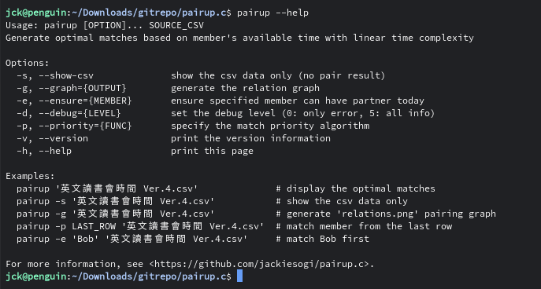

# pairup.c

`pairup` is a command-line tool that finds **optimal pairing results** for English study group.

Pairing is modeled as an integer linear program and solved exactly with [HiGHS](https://highs.dev), so the result always has the maximum number of pairs. The rules are:
- A pair meets in one time slot that both members filled in.
- A member joins at most as many pairs as they requested (1 or 2), uses each slot at most once, and never meets the same partner twice.
- With `--ensure`, listed members get a partner first whenever possible.
- With `--enable-flex`, the FLEX column is one more slot; fixed slots are preferred over it.

The model is described at the top of [`src/pairup/pairup-solver.c`](src/pairup/pairup-solver.c).



## Features
### Show the pair result


### Show the relation graph


## How to build

### Ubuntu 22.04

- Install the required packages.
```bash
sudo apt-get install build-essential make git cmake
```

- (Optional) Install HiGHS. If CMake cannot find it, it downloads and builds HiGHS automatically, which needs a C++ compiler and network access on the first build.
```bash
brew install highs   # macOS; on Linux, see https://ergo-code.github.io/HiGHS/stable/installation/
```

- Clone the repository.
```bash
git clone https://github.com/jackiesogi/pairup.c.git
cd pairup.c
```

- Run `make` to build the program.
```bash
(mkdir -p build; cd build; cmake ..; make)
```

- Run the tests (optional).
```bash
ctest --test-dir build
```

- Run `get-today-google-sheet.sh` to get the latest sheet (`pairup` will need the csv file it fetched).
```bash
./get-today-google-sheet.sh
```

- The main program `pairup` we built is located in project root.
```bash
./pairup --help
```

### Windows 10/11

- Install `Visual Studio`, `cmake`, `git`

- Clone the repository.
```bash
git clone https://github.com/jackiesogi/pairup.c.git
cd pairup.c
```

- Configure
```bash
mkdir build; cd build
cmake ..; cd ..
cmake --build build --target main
```
HiGHS is downloaded and built automatically on the first configure, unless it is already installed (point `CMAKE_PREFIX_PATH` at it).

After successful build, you'll see `pairup.exe` in the root directory.
